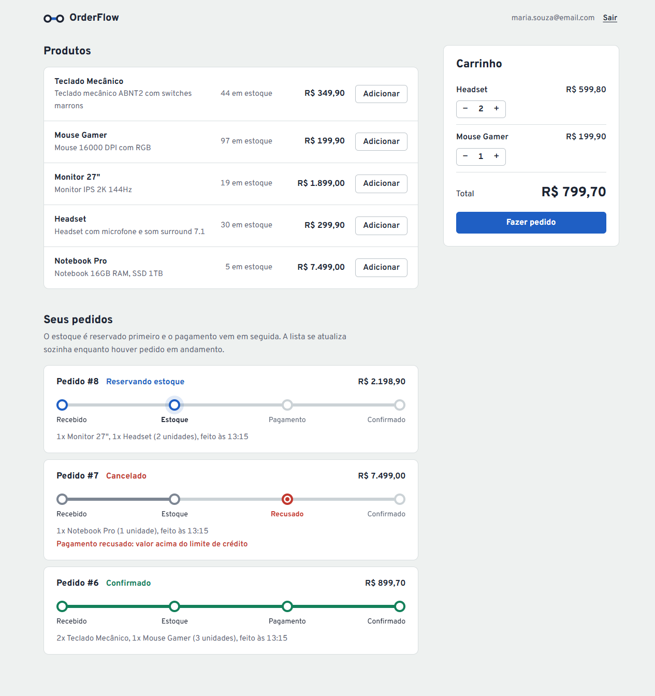
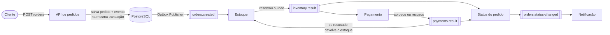
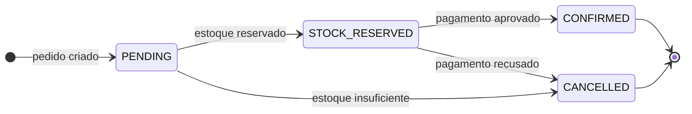
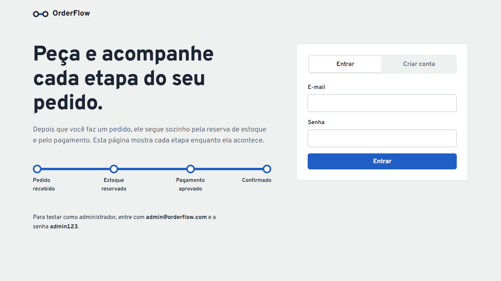
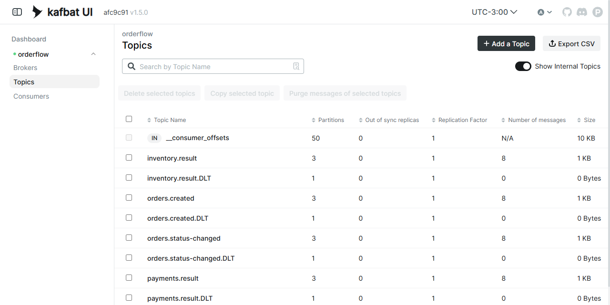
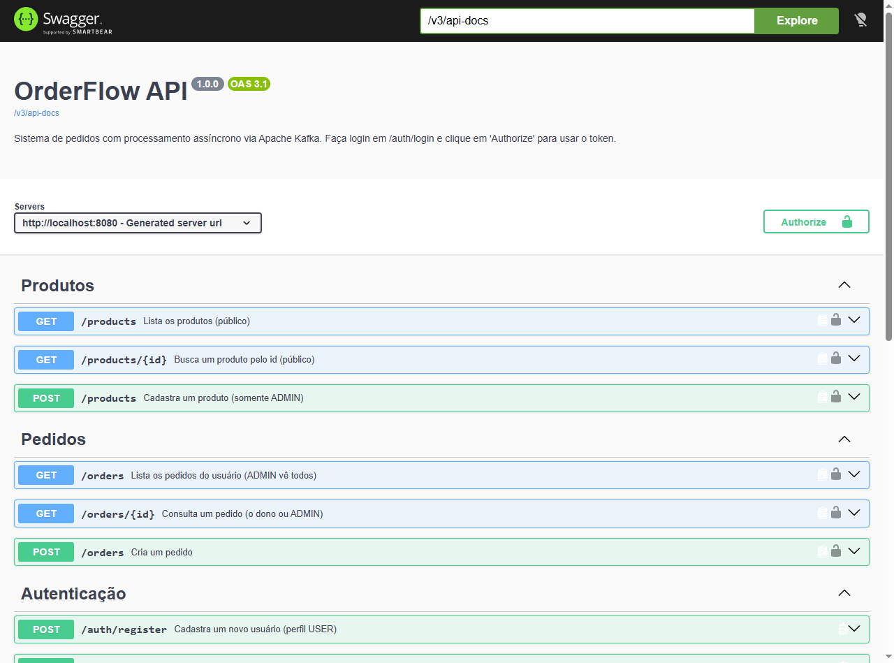

<div align="center">

# OrderFlow

**Sistema de pedidos com processamento assíncrono orientado a eventos**

Você faz o pedido, recebe a resposta na hora, e a reserva de estoque, o pagamento e a notificação
acontecem em segundo plano, conversando por mensagens no **Apache Kafka**.

[](https://github.com/MatheusCrivellaro/orderflow/actions/workflows/ci.yml)




</div>

---

## Sumário

- [Sobre o projeto](#sobre-o-projeto)
- [Como funciona](#como-funciona)
- [Tecnologias](#tecnologias)
- [Teste você mesmo em 5 minutos](#teste-você-mesmo-em-5-minutos)
- [Documentação da API](#documentação-da-api)
- [Testes automatizados](#testes-automatizados)
- [Decisões de arquitetura](#decisões-de-arquitetura)
- [Estrutura do projeto](#estrutura-do-projeto)
- [Configuração](#configuração)
- [Problemas comuns](#problemas-comuns)

---

## Sobre o projeto

Em uma loja online, confirmar um pedido envolve várias etapas: conferir o estoque, cobrar o cliente e avisar
que deu certo. Fazer tudo isso dentro de uma única requisição deixa a resposta lenta e faz qualquer falha em
um serviço externo derrubar a compra inteira.

O **OrderFlow** resolve isso com **processamento assíncrono**. A API só registra o pedido e devolve
`201 Created` com o status `PENDING`. A partir daí, cada etapa é feita por um componente independente que
reage a eventos publicados no Kafka.

O projeto também traz uma **interface web** para criar conta, montar o carrinho e acompanhar cada pedido
avançando pelas etapas em tempo real.

**O que dá para fazer:**

- Criar conta e entrar com autenticação JWT
- Ver o catálogo de produtos e montar um carrinho
- Fazer pedidos e acompanhar o status mudando sozinho
- Ver um pedido ser recusado e o estoque ser devolvido automaticamente
- Como administrador, cadastrar produtos e ver os pedidos de todos os clientes
- Inspecionar as mensagens que passam pelo Kafka no Kafka UI

---

## Como funciona



1. **Pedido recebido.** A API valida os produtos, calcula o total e salva o pedido como `PENDING`.
2. **Estoque.** O serviço de estoque tenta reservar todos os itens. Ou reserva tudo, ou não reserva nada.
3. **Pagamento.** Com o estoque reservado, o pagamento é processado. Ele é simulado: aprova pedidos de até R$ 5.000,00.
4. **Resultado.** O pedido termina `CONFIRMED` ou `CANCELLED`, e o serviço de notificação avisa o cliente (no log da aplicação).

### Ciclo de vida do pedido



| Situação | Resultado |
|---|---|
| Há estoque e o total é de até R$ 5.000,00 | Pedido `CONFIRMED` e estoque baixado |
| Algum item sem estoque suficiente | Pedido `CANCELLED` e nada é cobrado |
| Total acima de R$ 5.000,00 | Pedido `CANCELLED` e o estoque reservado é **devolvido** |

---

## Tecnologias

| Tecnologia | Para que foi usada |
|---|---|
| **Java 21** | Linguagem principal, com uso de `records`, `switch` moderno e text blocks |
| **Spring Boot 4** | Base da aplicação: API REST, validação, configuração e Actuator (health check) |
| **Spring Data JPA / Hibernate** | Mapeamento das entidades e acesso ao banco |
| **PostgreSQL 17** | Banco de dados relacional |
| **Flyway** | Versionamento do esquema do banco (migrations em SQL) |
| **Apache Kafka 4 (KRaft)** | Mensageria entre as etapas do pedido, sem Zookeeper |
| **Spring for Apache Kafka** | Producers, consumers, retentativas e Dead Letter Topic |
| **Spring Security + OAuth2 Resource Server** | Autenticação stateless com JWT e perfis `USER` / `ADMIN` |
| **springdoc-openapi (Swagger)** | Documentação interativa da API |
| **JUnit 5 + Mockito + AssertJ** | Testes unitários |
| **MockMvc** | Testes da camada web: status HTTP, validação e segurança |
| **Testcontainers** | Testes de integração com PostgreSQL e Kafka reais em containers |
| **Awaitility** | Esperar o processamento assíncrono dentro dos testes |
| **JaCoCo** | Relatório de cobertura de testes, com mínimo de 80% exigido no build |
| **Docker + Docker Compose** | Sobe a aplicação e toda a infraestrutura com um comando |
| **GitHub Actions** | CI: compila, testa e gera a imagem Docker a cada push |
| **Kafka UI (kafbat)** | Interface para ver tópicos e mensagens do Kafka |
| **HTML, CSS e JavaScript** | Interface web sem frameworks, servida pelo próprio Spring Boot |
| **Lombok** | Menos código repetitivo nas entidades e serviços |

---

## Teste você mesmo em 5 minutos

### Pré-requisitos

Você só precisa de dois programas. Não é preciso ter Java nem Maven instalados.

- [Git](https://git-scm.com/downloads)
- [Docker Desktop](https://www.docker.com/products/docker-desktop/), aberto e rodando

### 1. Baixe e suba o projeto

```bash
git clone https://github.com/MatheusCrivellaro/orderflow.git
cd orderflow
docker compose up -d --build
```

Na primeira vez, o Docker baixa as imagens e compila o projeto, o que leva alguns minutos.
Quando terminar, `docker compose ps` deve mostrar os quatro containers com status `healthy` ou `running`.

### 2. Acesse

| O quê | Endereço |
|---|---|
| **Interface web** | http://localhost:8080 |
| **Documentação da API (Swagger)** | http://localhost:8080/swagger-ui.html |
| **Kafka UI** | http://localhost:8081 |
| Health check | http://localhost:8080/actuator/health |



### 3. Roteiro sugerido

1. **Crie uma conta.** Em http://localhost:8080, clique em *Criar conta* e preencha nome, e-mail e uma senha de pelo menos 6 caracteres.
2. **Faça um pedido que dá certo.** Adicione um *Teclado Mecânico* e um *Mouse Gamer* e clique em *Fazer pedido*. A linha do pedido avança por *Recebido → Estoque → Pagamento → Confirmado* em poucos segundos.
3. **Faça um pedido que é recusado.** Adicione o *Notebook Pro* (R$ 7.499,00). O carrinho já avisa que o valor passa do limite. Depois de enviar, o pedido para em *Recusado* e o estoque do notebook volta ao valor original.
4. **Entre como administrador.** Clique em *Sair* e entre com `admin@orderflow.com` / `admin123`. O admin vê os pedidos de todos os clientes e pode cadastrar produtos em *Cadastrar novo produto*.
5. **Veja as mensagens no Kafka.** Abra http://localhost:8081, vá em *Topics* e clique em `orders.created` ou `payments.result` para ver os eventos em JSON.
6. **Veja a notificação simulada** no log da aplicação:

   ```bash
   docker compose logs app | grep NOTIFICA
   ```



### 4. Para desligar

```bash
docker compose down        # para os containers
docker compose down -v     # para os containers e também apaga os dados do banco
```

---

## Documentação da API

A API é documentada com **OpenAPI 3** e pode ser testada pelo navegador no **Swagger UI**:
**http://localhost:8080/swagger-ui.html**. A especificação em JSON fica em http://localhost:8080/v3/api-docs
e pode ser importada no Postman ou no Insomnia.



### Como usar rotas protegidas no Swagger

1. Abra `POST /auth/login`, clique em **Try it out** e envie:
   ```json
   { "email": "admin@orderflow.com", "password": "admin123" }
   ```
2. Copie o valor de `accessToken` da resposta.
3. Clique no botão **Authorize** no topo da página, cole o token e confirme.
4. Pronto: as rotas de pedidos e o cadastro de produtos passam a funcionar.

### Endpoints

| Método | Rota | Quem pode usar | O que faz |
|---|---|---|---|
| `POST` | `/auth/register` | Qualquer pessoa | Cria uma conta com perfil `USER` |
| `POST` | `/auth/login` | Qualquer pessoa | Devolve um token JWT válido por 60 minutos |
| `GET` | `/products` | Qualquer pessoa | Lista os produtos, com paginação |
| `GET` | `/products/{id}` | Qualquer pessoa | Mostra um produto |
| `POST` | `/products` | `ADMIN` | Cadastra um produto |
| `POST` | `/orders` | Usuário logado | Cria um pedido, que será processado em segundo plano |
| `GET` | `/orders/{id}` | Dono do pedido ou `ADMIN` | Mostra um pedido e o status atual |
| `GET` | `/orders` | Usuário logado | Lista os pedidos do usuário; o `ADMIN` vê todos |

### Exemplo pelo terminal

```bash
# Login
TOKEN=$(curl -s -X POST localhost:8080/auth/login \
  -H "Content-Type: application/json" \
  -d '{"email":"admin@orderflow.com","password":"admin123"}' | sed -E 's/.*"accessToken":"([^"]+)".*/\1/')

# Criar pedido: a resposta chega na hora, com status PENDING
curl -s -X POST localhost:8080/orders \
  -H "Authorization: Bearer $TOKEN" -H "Content-Type: application/json" \
  -d '{"items":[{"productId":1,"quantity":2},{"productId":2,"quantity":1}]}'

# Consultar de novo um ou dois segundos depois: status CONFIRMED
curl -s localhost:8080/orders/1 -H "Authorization: Bearer $TOKEN"
```

### Formato dos erros

Todos os erros seguem o padrão **Problem Details ([RFC 9457](https://www.rfc-editor.org/rfc/rfc9457))**.
Erros de validação também indicam qual campo está errado, com a mensagem no idioma pedido pelo
cabeçalho `Accept-Language`:

```json
{
  "title": "Bad Request",
  "status": 400,
  "detail": "Dados inválidos",
  "instance": "/orders",
  "errors": {
    "items[0].quantity": "deve ser maior que ou igual à 1"
  }
}
```

| Status | Quando acontece |
|---|---|
| `400` | Corpo da requisição inválido ou campo fora das regras |
| `401` | Token ausente, inválido ou expirado; ou e-mail e senha incorretos |
| `403` | Usuário sem permissão, como um `USER` tentando cadastrar produto |
| `404` | Produto ou pedido não encontrado, ou pedido de outro usuário |
| `409` | E-mail já cadastrado |

---

## Testes automatizados

O projeto tem **43 testes**, que rodam com um comando. É preciso ter o Docker aberto, porque os testes de
integração sobem PostgreSQL e Kafka de verdade:

```bash
./mvnw verify        # Linux / macOS / Git Bash
mvnw.cmd verify      # Windows (cmd ou PowerShell)
```

| Tipo | Ferramentas | O que é verificado |
|---|---|---|
| **Unitários** | JUnit 5, Mockito, AssertJ | Regras de status do pedido, reserva e devolução de estoque, limite do pagamento, login e cadastro, outbox e idempotência |
| **Camada web** | `@WebMvcTest`, MockMvc | Respostas `201`, `400`, `401` e `404`, validação dos campos e formato dos erros |
| **Integração** | `@SpringBootTest`, Testcontainers, Awaitility | O fluxo completo API → Kafka → consumers → banco nos três cenários, evento duplicado, permissões e login |

Exemplo de teste de integração que espera o processamento assíncrono terminar:

```java
Long orderId = createOrder(token, product.getId(), 2);

await().atMost(Duration.ofSeconds(30)).untilAsserted(() ->
        mockMvc.perform(get("/orders/" + orderId).header(AUTHORIZATION, bearer(token)))
                .andExpect(jsonPath("$.status").value("CONFIRMED")));

assertThat(stockOf(product)).isEqualTo(8);
```

**Cobertura:** depois do `verify`, o relatório do JaCoCo fica em `target/site/jacoco/index.html`.
A cobertura de linhas está em **95%**, e o build falha se ela ficar abaixo de 80%.

**Integração contínua:** a cada push ou Pull Request, o [GitHub Actions](.github/workflows/ci.yml) compila
o projeto, roda todos os testes (inclusive os com containers), publica o relatório de cobertura e gera a
imagem Docker.

---

## Decisões de arquitetura

<details>
<summary><strong>Transactional Outbox: nenhum evento se perde</strong></summary>

<br>

Se a API salvasse o pedido e depois publicasse no Kafka, uma queda entre as duas operações deixaria um pedido
sem evento, parado para sempre em `PENDING`. Por isso, o evento é gravado na tabela `outbox_events`
**na mesma transação** do pedido. Um job agendado (`OutboxPublisher`) lê os eventos pendentes e publica no
Kafka. Se o Kafka estiver fora do ar, os eventos esperam no banco e são enviados quando ele voltar.

</details>

<details>
<summary><strong>Idempotência: mensagem duplicada não é processada duas vezes</strong></summary>

<br>

O Kafka garante entrega *pelo menos uma vez*, então a mesma mensagem pode chegar repetida. Cada consumer
registra o `eventId` dos eventos que já processou na tabela `processed_events`, na mesma transação do
processamento. Se o evento aparecer de novo, ele é ignorado. Um teste de integração reenvia uma mensagem de
propósito e confirma que o estoque não é baixado duas vezes.

</details>

<details>
<summary><strong>Saga com compensação: devolver o estoque se o pagamento falhar</strong></summary>

<br>

Não existe uma transação de banco que cubra estoque e pagamento ao mesmo tempo. Se o pagamento é recusado
depois da reserva, o serviço de estoque recebe o evento `payments.result` e **devolve** os itens. É uma saga
coreografada: cada serviço reage aos eventos dos outros, sem um orquestrador central.

</details>

<details>
<summary><strong>Retentativas e Dead Letter Topic</strong></summary>

<br>

Se um consumer falha, a mensagem é retentada 3 vezes, com 1 segundo de intervalo. Se continuar falhando,
ela vai para um tópico `<nome>.DLT`, onde pode ser analisada sem travar o processamento das outras.
Mensagens com JSON inválido vão direto para o DLT, porque retentar não resolveria.

</details>

<details>
<summary><strong>Ordem e concorrência</strong></summary>

<br>

- **Ordem por pedido:** a chave de toda mensagem é o `orderId`, então os eventos de um mesmo pedido ficam na mesma partição e são lidos na ordem.
- **Estoque:** a reserva usa lock pessimista (`SELECT ... FOR UPDATE`), para dois pedidos simultâneos não venderem a mesma unidade.
- **Pedido:** a entidade usa lock otimista (`@Version`). As transições de status só andam para frente, então um evento atrasado não desfaz um status final.

</details>

<details>
<summary><strong>Monólito modular</strong></summary>

<br>

Pedidos, estoque, pagamento e notificação ficam na mesma aplicação, para o projeto ser simples de rodar.
Como os módulos só se comunicam por eventos no Kafka, cada um pode virar um microsserviço separado sem
mudar a lógica.

</details>

---

## Estrutura do projeto

```
orderflow
├── src/main/java/com/matheus/orderflow
│   ├── auth/            cadastro, login e geração do token JWT
│   ├── user/            usuário e criação automática do admin
│   ├── product/         catálogo de produtos
│   ├── order/           pedidos: API, regras de status e consumer dos resultados
│   ├── inventory/       reserva e devolução de estoque
│   ├── payment/         pagamento simulado
│   ├── notification/    notificação simulada
│   ├── messaging/       tópicos, eventos, outbox e idempotência
│   ├── common/          tratamento de erros e paginação
│   └── config/          segurança, Kafka e Swagger
├── src/main/resources
│   ├── db/migration/    scripts do Flyway (tabelas e produtos iniciais)
│   ├── static/          interface web (HTML, CSS e JS)
│   └── application.yml
├── src/test/java        testes unitários, de camada web e de integração
├── docker-compose.yml   PostgreSQL, Kafka, Kafka UI e aplicação
├── Dockerfile           build em duas etapas, com imagem final enxuta
└── .github/workflows    pipeline de CI
```

---

## Configuração

As configurações têm valores padrão para desenvolvimento e podem ser trocadas por variáveis de ambiente:

| Variável | Padrão | Descrição |
|---|---|---|
| `DB_URL` | `jdbc:postgresql://localhost:5432/orderflow` | URL do PostgreSQL |
| `DB_USERNAME` / `DB_PASSWORD` | `orderflow` / `orderflow` | Credenciais do banco |
| `KAFKA_BOOTSTRAP_SERVERS` | `localhost:9094` | Endereço do Kafka |
| `JWT_SECRET` | chave de desenvolvimento | Chave de assinatura do JWT, com no mínimo 32 caracteres |
| `ADMIN_EMAIL` / `ADMIN_PASSWORD` | `admin@orderflow.com` / `admin123` | Admin criado na primeira inicialização |

> Os valores padrão existem só para facilitar a demonstração. Em produção, defina `JWT_SECRET` e a senha do admin.

### Rodando a aplicação pela IDE

Para desenvolver, suba só a infraestrutura com o Docker e rode a aplicação pela IDE ou pelo Maven:

```bash
docker compose up -d postgres kafka kafka-ui
./mvnw spring-boot:run
```

---

## Problemas comuns

| Problema | Solução |
|---|---|
| `port is already allocated` ao subir o Compose | Alguma porta (5432, 8080, 8081 ou 9094) já está em uso. Pare o outro programa ou mude a porta do lado esquerdo em `docker-compose.yml`, por exemplo `"5433:5432"`. |
| `Cannot connect to the Docker daemon` | Abra o Docker Desktop e espere ele terminar de iniciar. |
| A página abre, mas o pedido não sai de `PENDING` | Veja se o Kafka está saudável com `docker compose ps` e confira o log com `docker compose logs app`. |
| Testes de integração falham com erro de Docker | Os testes usam Testcontainers e precisam do Docker rodando. |

---

<div align="center">

Feito por **[Matheus Crivellaro](https://github.com/MatheusCrivellaro)** como projeto de portfólio.

</div>
